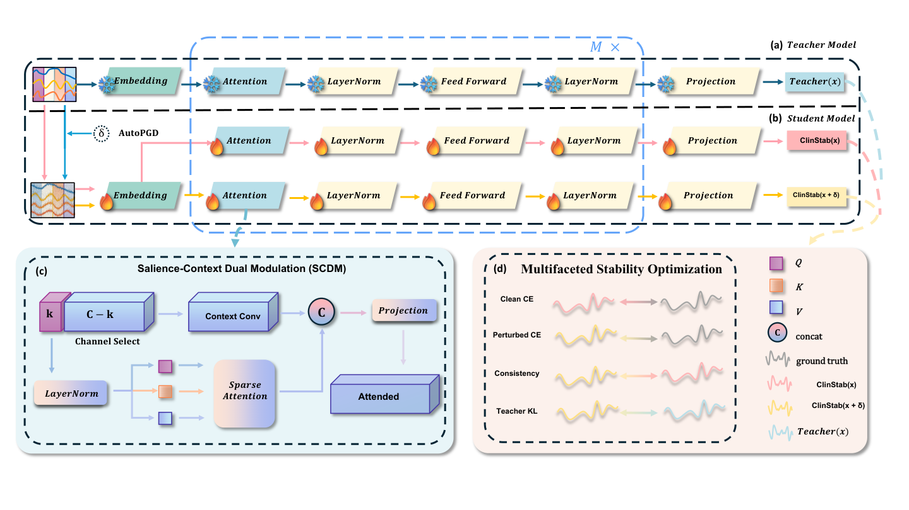

<div align="center">

# ClinStab

### Stability-Oriented Learning for Medical Time Series via Dual-Stream Alignment

<strong>Wenshuo Chen<sup>†</sup>, Haoxuan Xu<sup>†</sup>, Yi Liu, Songning Lai, Ninghui Feng, Jiayu Yang, Haoang Li, Yutao Yue<sup>*</sup></strong><br />
<sup>†</sup>Equal contribution · <sup>*</sup>Corresponding author

[](https://neurips.cc/Conferences/2026)
[](https://www.python.org/)
[](https://pytorch.org/)
[](LICENSE)

</div>

<p align="center">
  
</p>

ClinStab is a Medformer-style multi-granularity classifier for EEG and ECG. Its Salience-Context Dual Modulation (SCDM) routes high-energy channels to temporal attention and the remaining channels to a depth-wise context pathway. Stability training combines clean supervision, bounded perturbations, probability consistency, and a frozen teacher objective.

## Installation

```bash
git clone https://github.com/xll0328/NeurIPS26-ClinStb.git
cd NeurIPS26-ClinStb
python -m venv .venv
source .venv/bin/activate
python -m pip install --upgrade pip
python -m pip install --extra-index-url https://download.pytorch.org/whl/cu118 -r requirements.txt
```

Run the verification suite:

```bash
python -m unittest discover -s tests -v
```

## Data

Prepare each dataset as:

```text
dataset/DATA_NAME/
├── Feature/
│   ├── feature_1.npy
│   ├── feature_2.npy
│   └── ...
└── Label/label.npy
```

Each feature file has shape `[num_samples, sequence_length, channels]`. `label.npy` stores subject labels and IDs.

The built-in split definitions are subject level: APAVA, TDBRAIN, ADFTD, PTB and PTB-XL use the IDs defined in `data_provider/data_loader.py`; `ADFTD-Dependent` uses a deterministic sample-level 60/20/20 split. The train split is used to fit channel-wise normalization statistics, which are then reused for validation and test. The loader expects the feature filenames to be in natural sort order and aligned with the rows in `Label/label.npy`.

- [APAVA](https://osf.io/jbysn/)
- [TDBRAIN](https://brainclinics.com/resources/)
- [ADFTD](https://openneuro.org/datasets/ds004504/versions/1.0.6)
- [PTB](https://physionet.org/content/ptbdb/1.0.0/)

The loaders fit channel statistics on the training split and reuse them for validation and test data. Use `ADFTD-Dependent` for the subject-dependent ADFTD protocol and `ADFTD` for the subject-independent loader.

## Training

Clean ClinStab classification on APAVA:

```bash
python -u run.py \
  --task_name classification --is_training 1 \
  --root_path ./dataset/APAVA/ --model_id APAVA-Indep \
  --model ClinStab --data APAVA \
  --e_layers 6 --batch_size 64 --d_model 128 --d_ff 256 \
  --n_heads 8 --patch_len_list 2,4,8 --scdm_alpha 4.67 \
  --des ClinStab --itr 5 --learning_rate 0.0001 \
  --train_epochs 100 --patience 10
```

Stability training with a clean Medformer teacher:

```bash
python -u run_rob.py \
  --task_name classification --is_training 1 \
  --root_path ./dataset/APAVA/ --model_id APAVA-Indep \
  --model ClinStab --teacher_model Medformer --data APAVA \
  --e_layers 6 --batch_size 64 --d_model 128 --d_ff 256 \
  --n_heads 8 --patch_len_list 2,4,8 --scdm_alpha 4.67 \
  --des ClinStab --itr 5 --learning_rate 0.0001 \
  --train_epochs 100 --patience 10 \
  --eps 0.20 --steps 10 --rho 0.65 --max_restarts 1
```

The runner creates or reuses the clean ClinStab checkpoint and the clean Medformer teacher checkpoint for each seed. Pass `--teacher_checkpoint PATH` to use an existing teacher checkpoint. The SCDM attention budget is `max(1, floor(channels / scdm_alpha))`.

The clean run must finish first because robust training loads its student checkpoint. If the teacher checkpoint is not supplied, `run_rob.py` trains the configured teacher and stores it under `checkpoints/`. Validation F1 selects the robust checkpoint; the test set is evaluated only after training. Use `--use_gpu false` for CPU execution.

For evaluation of an existing clean checkpoint, run the same command with `--is_training 0`. Results are written below `results/`, while checkpoints are written below `checkpoints/`.

## Repository

```text
models/ClinStab.py                 SCDM classifier
utils/clinstab_objective.py       Stability objective and bounded PGD
run.py                             Clean training and evaluation
run_rob.py                         Stability training and evaluation
data_provider/                    Dataset loaders
exp/                               Experiment runners
tests/                             Verification tests
```

## Verification

```bash
python -m unittest discover -s tests -v
python -m compileall -q .
```

The tests cover SCDM forward and gradient behavior, channel-routing edge cases, bounded PGD perturbations, stability losses, and reuse of training normalization statistics. Full training requires the datasets and a compatible PyTorch installation.

## Citation

```bibtex
@inproceedings{clinstab2026,
  title={ClinStab: Stability-Oriented Learning for Medical Time Series via Dual-Stream Alignment},
  author={Chen, Wenshuo and Xu, Haoxuan and Liu, Yi and Lai, Songning and Feng, Ninghui and Yang, Jiayu and Li, Haoang and Yue, Yutao},
  booktitle={Advances in Neural Information Processing Systems},
  year={2026}
}
```

## License

MIT. Dataset access and upstream components remain subject to their respective provider terms.
